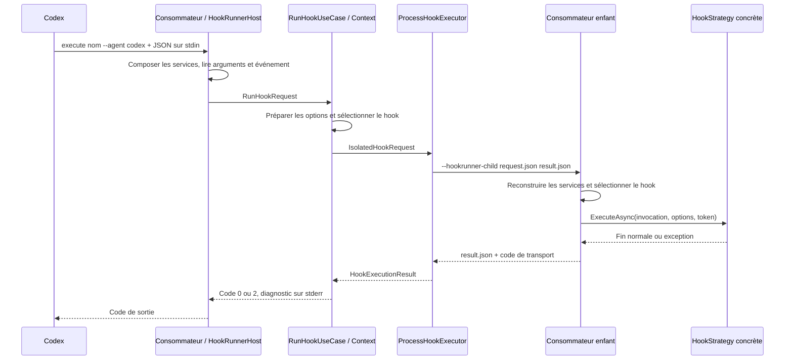

# Documentation technique du code

Cette documentation décrit le code C# présent dans le dépôt, y compris les
méthodes privées, les modèles, les outils CI, les fixtures et les tests. Elle
explique les responsabilités, les entrées et sorties, les effets de bord et
les erreurs utiles pour comprendre ou modifier chaque élément. Les liens
« Source » pointent vers les fichiers correspondants.

La [conception cible](../architecture.md) fixe les règles à atteindre ; les
pages ci-dessous décrivent leur implémentation actuelle. Le
[glossaire](../../GLOSSARY.md) définit les termes utilisés. Le
[guide consommateur](../consumer.md) explique comment intégrer la bibliothèque.

## Parcours de lecture

| Page | Contenu |
| --- | --- |
| [Application](application.md) | Contrats, modèles, sélection, contexte et cas d'usage. |
| [Infrastructure](infrastructure.md) | Événement Codex, préparation des options, commande enfant et protocole JSON. |
| [Cli](cli.md) | API d'hébergement, composition des services, arguments, configuration et point d'entrée enfant. |
| [Outils CI](ci.md) | Programme de contrôle, couverture, audit et liens de documentation. |
| [Tests et fixtures](tests-and-fixtures.md) | Consommateur de test, utilitaires, classes imbriquées et rôle de chaque méthode de test. |

`HookRunner.Domain` porte les règles de compteur, l'identité et l'exception de
validation métier, décrites avec leurs contrats dans [Application](application.md#stockage-et-règles-de-domain).
Les fichiers générés sous
`bin/` et `obj/`, les membres synthétisés par le compilateur et les bibliothèques
tierces ne font pas partie de cette référence. Pour les scripts et workflows,
consulter la [documentation CI](../ci.md) et les
[instructions de contribution](../../CONTRIBUTING.md).

## Organisation des sources

Les dossiers regroupent les responsabilités **à l'intérieur** des quatre couches.
Les contrats restent dans Application et leurs adaptateurs dans Infrastructure.
Les namespaces publics existants sont conservés pour préserver le code des
consommateurs ; l'arborescence physique ne change pas le graphe des dépendances.

| Projet | Dossiers |
| --- | --- |
| Application | `Abstractions/` pour les contrats de cas d'usage ; `Hooks/` pour les stratégies et l'invocation ; `Hooks/Options/` pour la préparation ; `Hooks/Execution/` pour le contexte et l'isolation ; `UseCases/RunHook/` pour le cas d'usage et ses messages. |
| Infrastructure | `Agents/Codex/` pour le protocole natif ; `Configuration/` pour la résolution des options ; `Execution/` pour les processus ; `Execution/Protocol/` pour le transport interne. |
| Cli | `Arguments/`, `Configuration/`, `Hosting/` et `Execution/` pour les quatre responsabilités d'intégration. |
| Tests | Dossiers par responsabilité ou couche ; `Support/` pour les utilitaires communs ; `Integration/` pour l'hôte complet. |
| Outils CI | `Hosting/` pour le point d'entrée ; `Quality/Audit/` et `Quality/Coverage/` pour les contrôles. |
| Fixture consommateur | `Hosting/`, `Hooks/`, `Services/` et `Observations/`. |

Chaque type de premier niveau possède son propre fichier. Les petits doubles
privés restent imbriqués dans leur suite de tests. Domain reste vide tant
qu'aucune règle métier pure n'y est implémentée.

Toutes les méthodes et tous les constructeurs écrits à la main portent des
commentaires XML : rôle, paramètres, retour, erreurs et effets utiles. Les
constructeurs primaires sont documentés sur leur type. Les builds de production
génèrent les fichiers XML destinés aussi aux consommateurs NuGet et refusent
les membres publics non documentés.

## Dépendances des couches

Les quatre projets de production ciblent `net11.0` et sont des bibliothèques.
Le programme exécutable appartient au projet consommateur.

| Couche | Références directes autorisées | Responsabilité actuelle |
| --- | --- | --- |
| Domain | Aucune | Réserve des règles métier. |
| Application | Domain | Définit et orchestre une invocation. |
| Infrastructure | Domain, Application | Adapte Codex et exécute un processus enfant. |
| Cli | Application, Infrastructure | Compose les services et choisit le mode d'entrée. |

L'[ADR 0004](../adr/0004-validated-layer-dependencies.md) définit ce graphe.
Les références transitives implicites entre projets sont désactivées ; les
tests d'architecture contrôlent les références évaluées par MSBuild et les
références réellement présentes dans les assemblies compilées.

## Une invocation de bout en bout



Le superviseur résout les stratégies pour valider leurs noms, mais exécute
uniquement l'adaptateur isolé. L'enfant recrée ses propres instances et appelle
la stratégie concrète. Le callback d'enregistrement doit donc fonctionner dans
les deux processus ; il ne doit pas dépendre d'objets construits seulement
dans le superviseur.

## Résultats et limites actuelles

| Situation | Comportement présent |
| --- | --- |
| Succès du hook | `Success`, trace sur stderr, code final `0`. |
| `HookValidationException` du hook | `ValidationFailure`, code final `2` sous plafond ou `0` au plafond. |
| Autre exception du hook | `TechnicalFailure` avec son message, code final `2`. |
| Arguments, événement ou configuration invalides | Diagnostic `HookRunner: ...`, code `2`, sans exécution du hook. |
| Résultat enfant manquant ou invalide | Erreur technique, code `2`. |
| Annulation externe pendant l'attente de l'enfant | Tentative d'arrêt de son arbre de processus, diagnostic, code `2`. |
| Timeout global avec arrêt confirmé | Arrêt forcé, trace sur stderr, code `0`, résultat métier tardif ignoré. |
| Échec de confirmation d'arrêt | Diagnostic technique, code `2`. |
| `ValidationFailure` sous plafond | Compteur incrémenté, diagnostic et code `2`. |
| `ValidationFailure` au plafond | Compteur conservé, trace et code `0`, hook toujours exécuté. |

Le code `0` de l'enfant indique que le fichier de résultat a pu être écrit ;
le statut du hook se lit dans ce fichier. Il peut donc signaler un échec alors
que le processus enfant a quitté avec `0`.

Seul l'agent `codex` est accepté. La sélection `--projects Api,Worker` résout
les noms exacts de fichiers C# dans toutes les solutions du premier dossier retenu,
avant exécution et accès aux compteurs. `TimeoutSeconds` est préparé puis appliqué par Context comme budget
unique couvrant l'attente du verrou, le démarrage et l'exécution isolée. La confirmation d'arrêt
utilise un délai technique distinct de cinq secondes. `StateFilePath` est
préparé et transmis ; un fichier d'état atomique conserve les compteurs entre lancements.
Un succès remet le compteur à zéro ; erreurs techniques et timeouts le conservent.
L'adaptation Claude et les services
de commandes et de prompts restent à implémenter. La présence d'un modèle
ou d'une valeur d'énumération ne signifie pas que le traitement associé existe.

## Conventions de lecture et de maintenance

Les `record` positionnels exposent les paramètres de leur constructeur sous
forme de propriétés. Sauf validation explicitement décrite, leur construction
ne vérifie pas les valeurs métier. `IReadOnlyList<T>` expose une lecture seule,
sans garantir que la collection sous-jacente est une copie immuable.

Les opérations asynchrones renvoient une `Task` à attendre. Le token
d'annulation circule entre les couches ; les frontières `Context` et
`HookRunnerHost` transforment aussi les exceptions d'annulation en code `2`.
Les objets `Context` portent l'état d'une invocation et ne sont pas conçus
pour des exécutions concurrentes partagées.

Lors d'un changement de classe, de méthode ou de protocole, mettre à jour la
page concernée et vérifier les liens depuis la racine du dépôt :

```powershell
dotnet run --project tools/HookRunner.CI --configuration Release -- docs .
```

Ce contrôle vérifie l'existence des cibles locales Markdown. Il ne valide ni
les ancres, ni les liens externes, ni l'exactitude des descriptions : celles-ci
doivent être relues avec le code et les tests.
